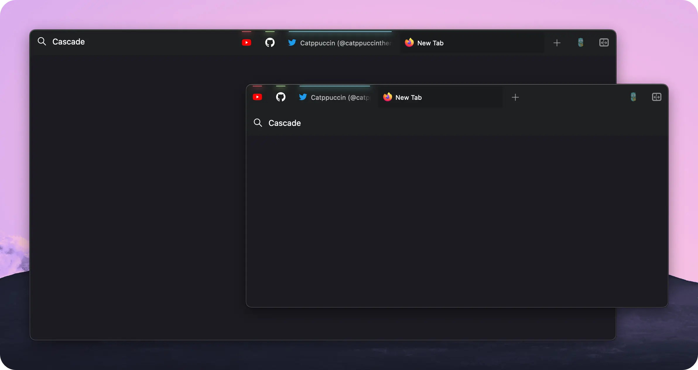

  

It hurts me to say this, but it's for the best. As some probably have noticed: This repo got quite stale. The reason for this is that I'm not really finding much time to work on this, iron out bugs and things that got broken due to Firefox updates. Furthermore I've recently switched to another browser which already offers quite a few of the ultimate features I wanted for Cascade by default and in a way that is a lot better than what I could have done with Firefox. I'm looking to move this repostory to an Org in order for potential new maintainers to have an easy transition into working on this. Again; I'm sorry, but y'all deserve better than my on-off relationship with this theme.

[If you're up for it, feel free to reach out! <3](https://github.com/andreasgrafen/cascade/discussions/116)

  

# Cascade

**A minimalistic and keyboard centered userChrome**

Cascade aims to remove a lot of the subjective clutter default Firefox comes with. The theme is also highly inspired by the stylistic choices of [SimpleFox](https://github.com/migueravila/SimpleFox) 🦊 by [Miguel Ávila](https://github.com/migueravila).

 

  
  
  
  

---

### Documentation

**[Installation](https://cascadefox.github.io/installation.html) • [Customisation](https://cascadefox.github.io/customisation.html) • [Integrations](https://cascadefox.github.io/integrations.html) • [Keyboard Shortcuts](https://cascadefox.github.io/shortcuts.html)**

 